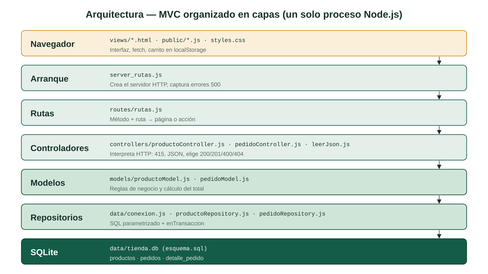
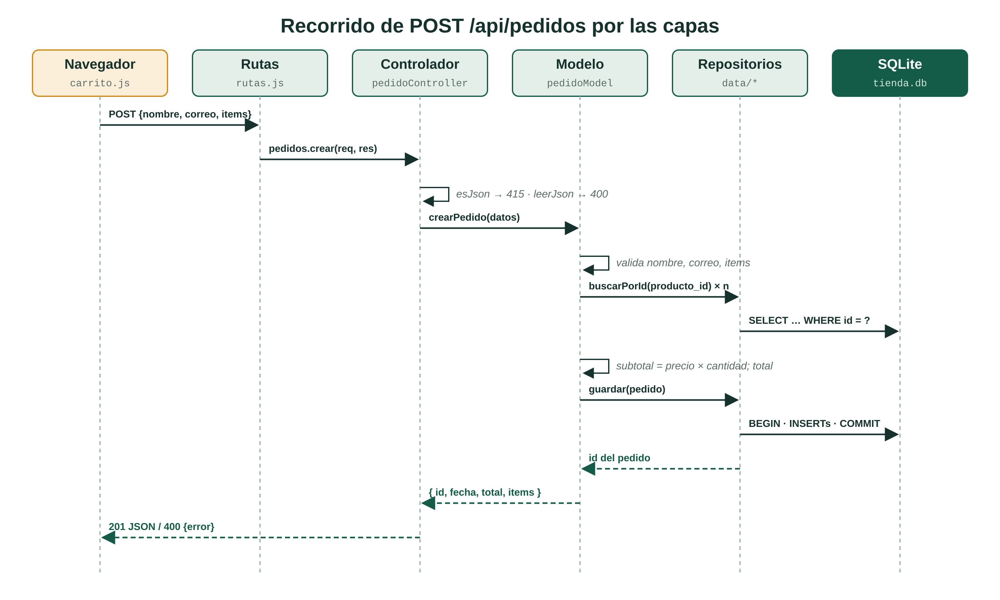
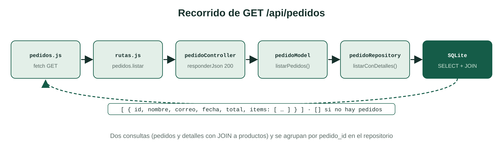

# Arquitectura — MVC organizado en capas

Todo corre en un solo proceso Node.js, solo con módulos nativos (`node:http`, `node:fs`, `node:path`, `node:sqlite`) y `require()`.

| Capa | Archivos | Responsabilidad | No hace |
|---|---|---|---|
| Arranque | `server_rutas.js` | Crea el servidor, delega en el enrutador, responde 500 ante errores no esperados, cierra la base | Rutas, reglas o SQL |
| Rutas | `routes/rutas.js` | Elige página, recurso estático o acción del controlador según método + ruta | Validar o consultar datos |
| Controladores | `controllers/*.js` | Comprueba `Content-Type` (415), lee JSON (400/413), llama al modelo y elige código 200/201/400/404 | SQL ni reglas de negocio |
| Modelos | `models/*.js` | Valida nombre, correo e ítems; agrupa repetidos; calcula subtotales y total con precios de SQLite; lanza `ErrorValidacion` | Conocer `req`/`res` |
| Repositorios | `data/*.js` | Conexión, esquema, siembra, consultas parametrizadas (`?`) y `enTransaccion` | Enviar respuestas HTTP |
| Vistas | `views/*.html`, `views/respuestas.js`, `public/*` | Interfaz, `fetch`, carrito en `localStorage`, formato JSON de respuesta | Calcular el total real |

## Recorrido de un POST

1. `public/carrito.js` envía `fetch('/api/pedidos', {method:'POST', body: JSON.stringify({nombre, correo, items})})`.
2. `routes/rutas.js` detecta `POST /api/pedidos` → `pedidoController.crear`.
3. El controlador verifica `Content-Type` y lee el cuerpo con `leerJson`.
4. `pedidoModel.crearPedido` valida, consulta cada producto con `productoRepository.buscarPorId`, agrupa repetidos y calcula el total.
5. `pedidoRepository.guardar` ejecuta `BEGIN → INSERT pedidos → INSERT detalle_pedido × n → COMMIT` (o `ROLLBACK`).
6. El controlador responde **201** con el pedido, o **400** si el modelo lanzó `ErrorValidacion`.

## Recorrido de un GET

`public/pedidos.js` → `rutas.js` → `pedidoController.listar` → `pedidoModel.listarPedidos` → `pedidoRepository.listarConDetalles` (dos `SELECT`, uno con `JOIN productos`, agrupados por `pedido_id`) → **200** con el arreglo (o `[]`).
