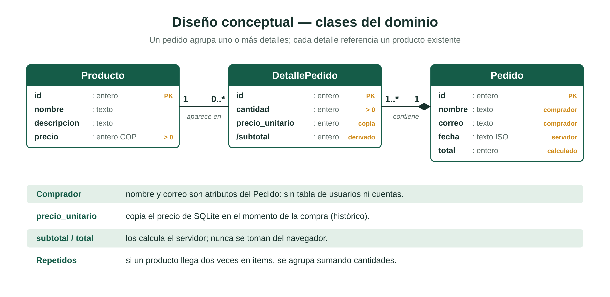
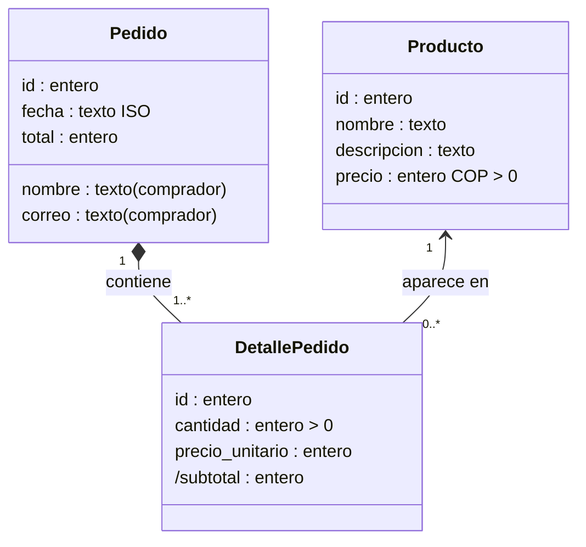
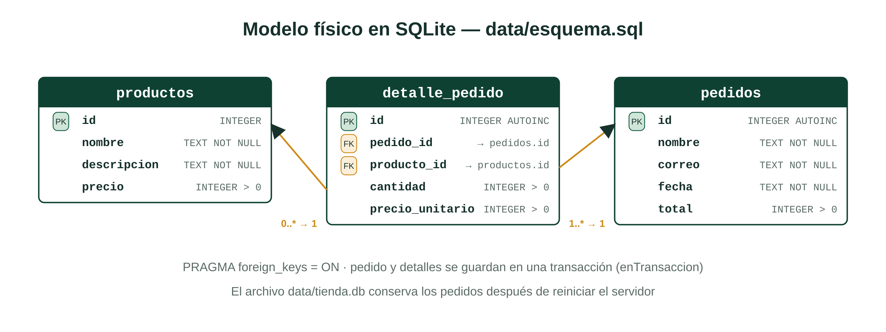
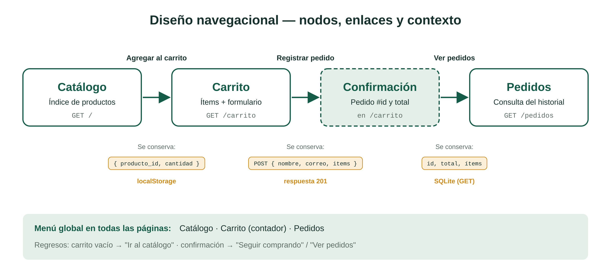
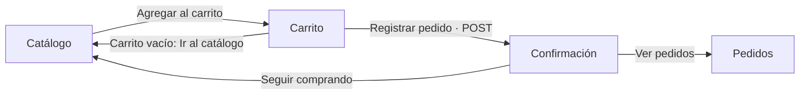
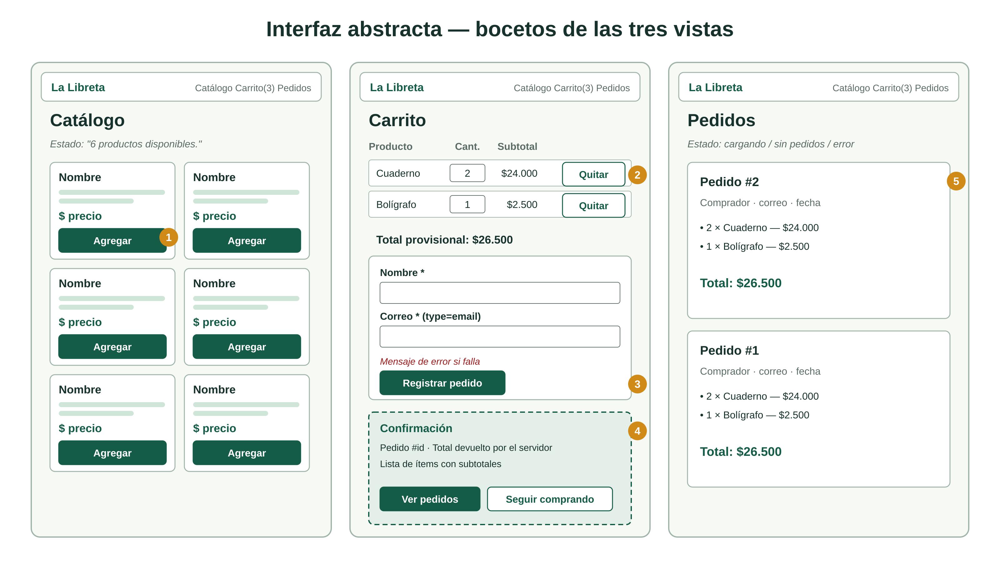

# Aplicación de OOHDM — La Libreta

**Actor:** comprador anónimo (sin cuentas ni autenticación).
**Requisitos de entrada:** consultar el catálogo, armar un carrito, registrar un pedido con nombre y correo, y consultar los pedidos registrados.

## 1. Diseño conceptual

- **Producto:** artículo del catálogo con precio en COP enteros.
- **Pedido:** compra registrada. Los **datos del comprador** (nombre y correo) son atributos del pedido; no existe una clase o tabla de usuarios porque no hay cuentas.
- **DetallePedido:** línea del pedido. Relaciona un pedido con un producto y guarda la cantidad y una copia del `precio_unitario` vigente al comprar (si el precio cambia después, el pedido histórico no se altera). `subtotal` es derivado (`cantidad × precio_unitario`).
- **Cardinalidades:** un pedido tiene uno o más detalles (composición); un producto puede aparecer en cero o muchos detalles de distintos pedidos.

Modelo físico correspondiente:

## 2. Diseño navegacional

| Elemento | Tipo | Información o función |
|---|---|---|
| Catálogo | Índice (estructura de acceso) | Lista de productos con nombre, descripción, precio y botón *Agregar* |
| Carrito | Nodo | Ítems, cantidades editables, subtotales, total provisional y formulario |
| Confirmación | Nodo (contexto dentro de `/carrito`) | `id`, ítems y total devueltos por el servidor |
| Pedidos | Índice | Pedidos registrados con comprador, fecha, total y productos |

**Información que se conserva entre nodos**

| Paso | Qué viaja | Dónde |
|---|---|---|
| Catálogo → Carrito | `[{producto_id, cantidad}]` | `localStorage` del navegador |
| Carrito → Confirmación | `{nombre, correo, items}` (sin precios) y la respuesta `{id, total, items}` | Cuerpo del `POST /api/pedidos` y su respuesta 201 |
| Confirmación → Pedidos | Pedido persistido | SQLite, leído con `GET /api/pedidos` |

Un menú global (Catálogo · Carrito con contador · Pedidos) está presente en todas las páginas.

## 3. Diseño de interfaz abstracta

| # | Vista | Información visible / campos | Acción | Respuesta esperada |
|---|---|---|---|---|
| 1 | Catálogo | Nombre, descripción, precio; mensaje de estado | *Agregar al carrito* | Suma 1 unidad en `localStorage`, actualiza contador y estado “X agregado” |
| 2 | Carrito | Producto, precio, cantidad (`number`, mín. 1), subtotal, total provisional | Cambiar cantidad / *Quitar* | Recalcula subtotales y total; si queda vacío muestra “Tu carrito está vacío” |
| 3 | Carrito – formulario | Nombre (`text`, obligatorio), Correo (`email`, obligatorio) | *Registrar pedido* | Botón en “Registrando…”; si falla, mensaje de error visible y el carrito se conserva |
| 4 | Confirmación | Pedido #id, ítems con subtotales, total del servidor | *Ver pedidos* / *Seguir comprando* | Navega a Pedidos o al Catálogo; el carrito ya fue vaciado |
| 5 | Pedidos | #id, comprador, correo, fecha, productos con cantidades, total | (consulta al cargar) | Estados: “Consultando…”, “Todavía no hay pedidos” o error |

Los colores y la distribución pertenecen a la implementación, no a esta especificación abstracta.

## 4. Implementación

Aplicación ejecutable con `npm start`. Esquema de arquitectura en [ARQUITECTURA.md](ARQUITECTURA.md).

| Decisión de diseño | Materialización concreta |
|---|---|
| Clases Producto, Pedido, DetallePedido | Tablas `productos`, `pedidos`, `detalle_pedido` (`data/esquema.sql`) |
| Relación Pedido 1 — 1..* DetallePedido | FK `detalle_pedido.pedido_id`; inserción en `enTransaccion` (`data/pedidoRepository.js → guardar`) |
| Relación Producto 1 — 0..* DetallePedido | FK `detalle_pedido.producto_id`; `JOIN productos` en `listarConDetalles` |
| Comprador como atributo del pedido | Columnas `pedidos.nombre` y `pedidos.correo`; validación en `models/pedidoModel.js` |
| `precio_unitario` copiado y total calculado | `pedidoModel.crearPedido` consulta `productoRepository.buscarPorId` y calcula subtotales/total |
| Nodo Catálogo (índice) | `GET /` → `views/index.html` + `public/catalogo.js` con `GET /api/productos` |
| Contexto Catálogo → Carrito | `public/carrito-storage.js` (`localStorage`) |
| Nodo Carrito + Confirmación | `GET /carrito` → `views/carrito.html` + `public/carrito.js` con `POST /api/pedidos` |
| Nodo Pedidos (índice) | `GET /pedidos` → `views/pedidos.html` + `public/pedidos.js` con `GET /api/pedidos` |
