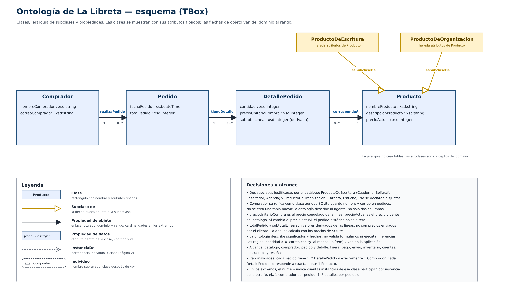
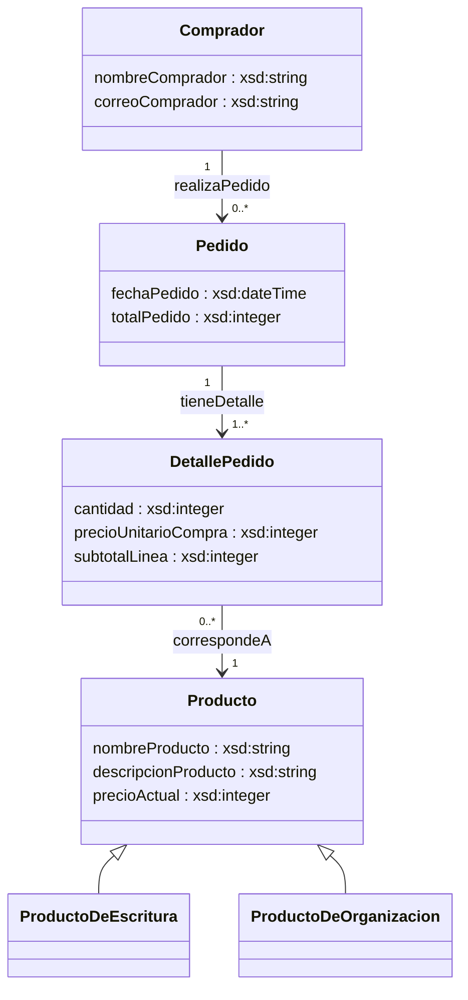
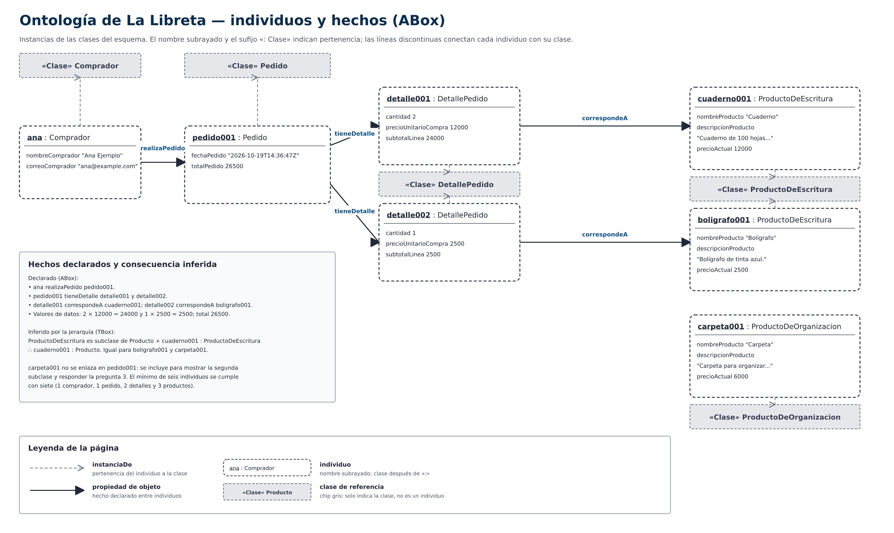

# Ficha del modelo ontológico — La Libreta

**Seguimiento del 10 % · Diagrama de ontología · Ingeniería Web**  
**Proyecto:** La Libreta — papelería académica  
**Integrante:** Juan Ramírez Herrera  
**Docente:** Luis Miguel Gómez Meneses  
**Universidad Cooperativa de Colombia · Noviembre de 2026**

## 1. Propósito, usuarios y alcance

La ontología describe el dominio de **La Libreta** (papelería académica) para dar significado compartido a productos, comprador, pedido y detalles. Debe permitir responder qué se vende, quién compra, qué contiene un pedido y cómo se relacionan el precio de compra con el precio actual del catálogo. Los usuarios previstos son el equipo desarrollador —vocabulario y correspondencia con el código—, el docente —evaluación— y mantenedores futuros; no es una interfaz para el cliente final. El alcance se limita al catálogo, comprador, pedido y detalle. Quedan fuera pagos, envíos, inventario, cuentas y autenticación, descuentos, reseñas y categorías adicionales. La ontología describe significados y hechos: no reemplaza las validaciones de la aplicación ni ejecuta un razonador.

## 2. Preguntas de competencia

**P1** y **P2** se responden con hechos declarados; **P3** requiere la jerarquía. Los recorridos usan los individuos de la página 2 del diagrama.

| # | Pregunta | Recorrido en el modelo | Respuesta con los individuos |
|---|---|---|---|
| P1 | ¿Qué productos aparecen en un pedido concreto y con qué cantidades? | `pedido001` → `tieneDetalle` → `detalle001`/`detalle002` → `correspondeA` → `cuaderno001`/`boligrafo001`; leer `cantidad`. | `pedido001`: 2 cuadernos (`detalle001`) y 1 bolígrafo (`detalle002`). |
| P2 | ¿Quién realizó un pedido concreto? | `pedido001` ← `realizaPedido` ← `ana`; leer `nombreComprador` y `correoComprador`. | `ana` (Ana Ejemplo, ana@example.com) realizó `pedido001`. |
| P3 | ¿Qué individuos pertenecen a `Producto` al considerar la jerarquía de subclases? | `cuaderno001` y `boligrafo001` : `ProductoDeEscritura`; `carpeta001` : `ProductoDeOrganizacion`; ambas subclases de `Producto`. | `cuaderno001`, `boligrafo001` y `carpeta001` pertenecen a `Producto` por la jerarquía. |

## 3. Clases y jerarquía

Las **clases** son conceptos generales; los **individuos** son registros concretos. La página 1 muestra el esquema; la página 2, los individuos. El modelo no crea una subclase por producto: Cuaderno, Bolígrafo, etc. son individuos.

| Clase | Significado | Correspondencia con la app |
|---|---|---|
| `Producto` | Artículo del catálogo con nombre, descripción y precio actual. | Tabla `productos`; `GET /api/productos`. |
| `ProductoDeEscritura` | Subclase de `Producto`: se usa para escribir, resaltar o registrar (Cuaderno, Bolígrafo, Resaltador, Agenda). | No es tabla; se reconoce por nombre y descripción. |
| `ProductoDeOrganizacion` | Subclase de `Producto`: guarda, protege u ordena útiles (Carpeta, Estuche). | No es tabla; se reconoce por nombre y descripción. |
| `Comprador` | Agente que realiza un pedido; nombre y correo. | Columnas `pedidos.nombre` y `pedidos.correo`. |
| `Pedido` | Compra registrada con fecha y total. | Tabla `pedidos`; `POST`/`GET /api/pedidos`. |
| `DetallePedido` | Línea: producto, cantidad y precio congelado. | Tabla `detalle_pedido`. |

**Jerarquía.** El catálogo permite dos grupos funcionales: cuatro productos de escritura/registro y dos de organización. No se declaran disjuntas porque el catálogo no establece exclusividad; la ontología deja abierta la posibilidad de que un producto cumpla ambas funciones.

**Comprador.** La app guarda nombre y correo en `pedidos`, sin tabla de compradores. Se reifica `Comprador` porque el dominio distingue al agente del pedido; no se crea una tabla nueva. No hay cuentas ni identificador estable: el mismo correo en dos pedidos no prueba que sea la misma persona. Por eso `correoComprador` no es único y no se infiere identidad entre pedidos; lo no registrado no se considera falso (mundo abierto).

## 4. Propiedades del modelo

Las propiedades de objeto conectan individuos de dos clases; las de datos asignan un valor literal tipado. El sentido de la flecha del diagrama es **dominio → rango**.

### 4.1 Propiedades de objeto

| Propiedad | Significado | Dominio | Rango | Cardinalidad |
|---|---|---|---|---|
| `realizaPedido` | El comprador realiza el pedido. | `Comprador` | `Pedido` | 1 comprador por pedido; 0..* pedidos por comprador. |
| `tieneDetalle` | El pedido contiene una línea. | `Pedido` | `DetallePedido` | 1..* detalles por pedido; 1 pedido por detalle. |
| `correspondeA` | La línea referencia el producto. | `DetallePedido` | `Producto` | 1 producto por detalle; 0..* detalles por producto. |

### 4.2 Propiedades de datos

| Propiedad | Significado | Dominio | Tipo (rango) |
|---|---|---|---|
| `nombreComprador` | Nombre informado por el comprador. | `Comprador` | `xsd:string` |
| `correoComprador` | Correo informado por el comprador. | `Comprador` | `xsd:string` |
| `fechaPedido` | Fecha y hora de registro (ISO 8601, UTC). | `Pedido` | `xsd:dateTime` |
| `totalPedido` | Suma de subtotales, en COP enteros. | `Pedido` | `xsd:integer` |
| `cantidad` | Unidades compradas; entero > 0. | `DetallePedido` | `xsd:integer` |
| `precioUnitarioCompra` | Precio congelado al comprar, en COP enteros. | `DetallePedido` | `xsd:integer` |
| `subtotalLinea` | `cantidad × precioUnitarioCompra`; derivada. | `DetallePedido` | `xsd:integer` |
| `nombreProducto` | Nombre comercial del catálogo. | `Producto` | `xsd:string` |
| `descripcionProducto` | Descripción del catálogo. | `Producto` | `xsd:string` |
| `precioActual` | Precio vigente del catálogo, en COP enteros. | `Producto` | `xsd:integer` |

> **Dos precios que no significan lo mismo.** `precioUnitarioCompra` es el precio congelado de la línea y vive en `DetallePedido`; `precioActual` es el precio vigente del catálogo y vive en `Producto`. Si el catálogo cambia, el pedido histórico no se altera. `totalPedido` y `subtotalLinea` son derivados: los calcula la app con los precios de SQLite; no vienen del cliente.

## 5. Individuos y hechos

Siete individuos (mínimo seis): un comprador, un pedido, dos detalles y tres productos. Los nombres en minúscula son etiquetas locales de individuo, no nombres de clase.

| Individuo | Clase | Datos | Enlaces |
|---|---|---|---|
| `ana` | `Comprador` | nombre "Ana Ejemplo"; correo "ana@example.com" | `realizaPedido` → `pedido001` |
| `pedido001` | `Pedido` | fecha "2026-10-19T14:36:47Z"; total 26500 | `tieneDetalle` → `detalle001`, `detalle002` |
| `detalle001` | `DetallePedido` | cantidad 2; precioUnitarioCompra 12000; subtotalLinea 24000 | `correspondeA` → `cuaderno001` |
| `detalle002` | `DetallePedido` | cantidad 1; precioUnitarioCompra 2500; subtotalLinea 2500 | `correspondeA` → `boligrafo001` |
| `cuaderno001` | `ProductoDeEscritura` | nombre "Cuaderno"; descripción "Cuaderno de 100 hojas..."; precioActual 12000 | participa en `detalle001` |
| `boligrafo001` | `ProductoDeEscritura` | nombre "Bolígrafo"; descripción "Bolígrafo de tinta azul."; precioActual 2500 | participa en `detalle002` |
| `carpeta001` | `ProductoDeOrganizacion` | nombre "Carpeta"; descripción "Carpeta para organizar..."; precioActual 6000 | no se enlaza en el ejemplo |

`carpeta001` se incluye para mostrar la segunda subclase y responder **P3**. El pedido coincide con el contrato de la API: 2 × 12000 + 1 × 2500 = 26500 COP.

## 6. Consecuencia por subclases

La consecuencia se obtiene aplicando la regla de subclase: si C es subclase de D, todo individuo de C es también individuo de D. Hay dos afirmaciones declaradas y una conclusión inferida:

> **Premisa 1 (TBox):** `ProductoDeEscritura` es subclase de `Producto`.  
> **Premisa 2 (ABox):** `cuaderno001` es individuo de `ProductoDeEscritura`.  
> **Conclusión:** `cuaderno001` es individuo de `Producto`.

La conclusión es una consecuencia del modelo, no una fila nueva. Lo mismo ocurre con `boligrafo001` (por `ProductoDeEscritura`) y `carpeta001` (por `ProductoDeOrganizacion`). El diagrama muestra la pertenencia a la subclase y la flecha de subclase hacia `Producto`; la pertenencia a `Producto` se lee por la jerarquía. No se infiere que `cuaderno001` sea de `ProductoDeOrganizacion`. El dibujo por sí solo no ejecuta la inferencia: la regla se aplica manualmente o con un razonador.

## 7. Correspondencia con la aplicación y decisiones

| Concepto ontológico | Implementación en La Libreta | Tipo de correspondencia |
|---|---|---|
| `Producto` | Tabla `productos` (`nombre`, `descripcion`, `precio`) | Clase ↔ tabla; `precioActual` ↔ `precio` |
| `Comprador` | Columnas `pedidos.nombre` y `pedidos.correo` | Clase reificada ↔ dos columnas; sin tabla |
| `Pedido` | Tabla `pedidos` (`fecha`, `total`) | Clase ↔ tabla |
| `DetallePedido` | Tabla `detalle_pedido` (`pedido_id`, `producto_id`, `cantidad`, `precio_unitario`) | Clase ↔ tabla; `precioUnitarioCompra` ↔ `precio_unitario` |
| `realizaPedido` | Nombre y correo guardados en el pedido | Vínculo implícito; no hay FK a comprador |
| `tieneDetalle` / `correspondeA` | FK `detalle_pedido.pedido_id` / `producto_id` + `JOIN` | 1..* detalles y 1 producto por línea |
| `totalPedido` / `subtotalLinea` | Calculados por `pedidoModel`; `subtotal` no es columna | Derivados |
| Subclases de `Producto` | Sin tablas ni columnas; se reconocen por nombre y descripción | Ampliación conceptual |

**Simplificaciones y ampliaciones.** El comprador se reifica aunque no haya tabla de compradores: es una ampliación para representar al agente, no un cambio de SQLite. No se modelan cuentas ni identidad estable; el correo repetido no se interpreta como la misma persona. Pagos, envíos, inventario, descuentos y reseñas quedan fuera de alcance. No se declaran las subclases disjuntas. Los `id` numéricos de SQLite no se modelan como propiedades de datos; los individuos se identifican por su etiqueta local. Las reglas de la app (`cantidad > 0`, correo con `@`, al menos un ítem) no son axiomas ontológicos: dominio y rango indican qué individuos pueden participar en una propiedad, no validan formularios. Lo no registrado no se considera falso: la ontología conserva información desconocida.

## 8. Convenciones del diagrama y entregables

- **Clase:** rectángulo sólido con nombre en negrita y atributos con tipo `xsd`; las subclases heredan los atributos de `Producto`.
- **Subclase:** línea sólida con triángulo hueco hacia la superclase, rotulada `esSubclaseDe`.
- **Propiedad de objeto:** flecha rellena dominio → rango con cardinalidades en los extremos.
- **Propiedad de datos:** atributo dentro de la clase, con tipo `xsd`; no se dibuja como flecha.
- **Individuo:** rectángulo redondeado con borde discontinuo, nombre subrayado y la forma `individuo : Clase`; la pertenencia se refuerza con una flecha discontinua `instanciaDe` hacia el chip de clase.
- **Entregables:** `ontologia_tienda.drawio` (editable, dos páginas), `1_esquema_ontologia.png`, `2_individuos_ontologia.png` y esta ficha en PDF. La página 1 contiene el esquema (TBox); la página 2, los individuos (ABox).

## Referentes

- Noy, N. F. y McGuinness, D. L. *Ontology Development 101*. https://protege.stanford.edu/publications/ontology_development/ontology101.pdf
- W3C. *OWL 2 Primer*. https://www.w3.org/TR/owl2-primer/
